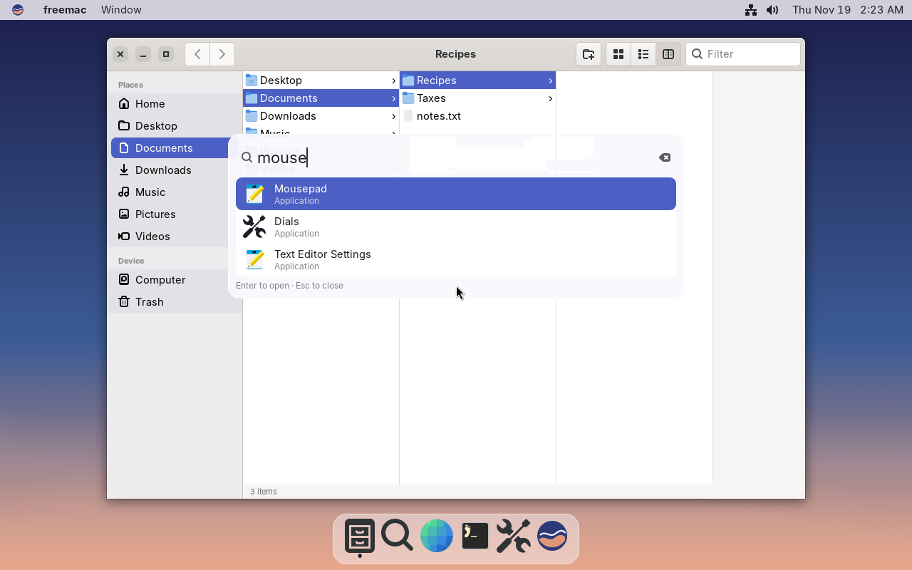
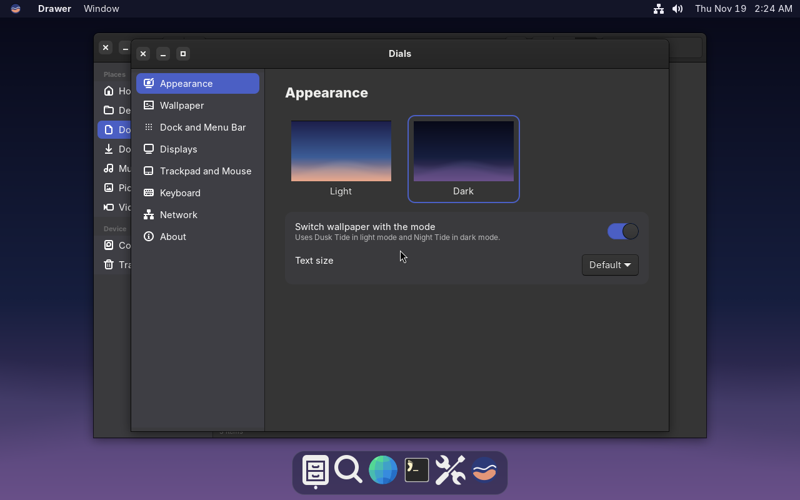
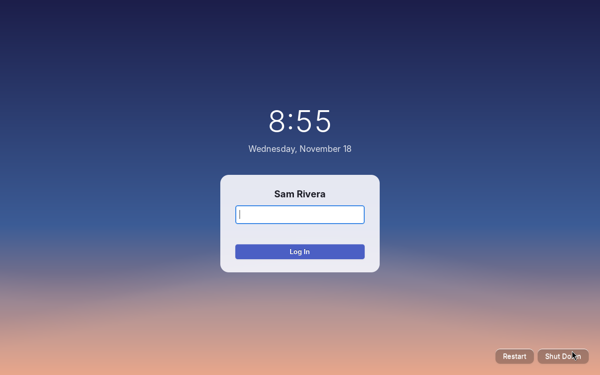

# freemac

freemac is an original, free operating system for ordinary x86-64 PCs whose
desktop *feels* like a classic Mac-style desktop: a global menu bar along the
top, a dock along the bottom, calm window chrome, a fast search launcher and
trackpad gestures that just work.

It is a small Linux distribution (Debian base) with its own Wayland desktop
shell. It is **not** macOS and it contains nothing from Apple. An optional
add-on, [Ferry](ferry/README.md), runs some simple command-line programs built
for Intel Macs; Mac apps in general, and App Store apps in particular, do not
run.

## Clean-room rules

These rules apply to every commit, issue and pull request. A change that breaks
one of them will be reverted.

1. **No Apple material.** No Apple source code, binaries, firmware, kexts,
   frameworks, fonts, icons, cursors, wallpapers, sounds, screenshots or other
   artwork, in the repository or in built images.
2. **No reverse engineering of Apple software.** Do not disassemble, decompile,
   trace or dump macOS or any other Apple software, and do not use tools that do
   so on your behalf. Do not copy code or data obtained that way by anyone else.
3. **Design from public descriptions only.** Behaviour is designed from how the
   user experience is publicly described (articles, reviews, user guides,
   general knowledge of how such desktops work) and implemented from scratch.
4. **Original names and look.** Components get original names. Window buttons,
   icons and themes are our own designs. Do not imitate Apple's exact shapes,
   colours or layouts pixel for pixel.
5. **No Apple trademarks.** Do not use Apple, Mac, macOS, Finder, Dock,
   Spotlight, Mission Control or similar marks as names of anything we ship.
   (The repository name `freemac` is a working project name; a final product
   name may be chosen before any public release.)
6. **Only compatible open-source parts.** Third-party code must be under a
   licence compatible with GPL-3.0-or-later and must be recorded in
   [docs/ARCHITECTURE.md](docs/ARCHITECTURE.md).

## Target experience

| Feature | Our component | Status |
| --- | --- | --- |
| Global top menu bar with app menu, window menu, status icons, clock | **Topline** | 0.4: own bar with network, sound and battery icons; 0.5: clock opens the notification centre; 0.6: Lock Screen item; app menus exported by apps planned for 0.8 |
| Bottom dock with magnification, running indicators | **Pier** | 0.4 |
| Desktop wallpaper that fills any screen shape | **Backdrop** | 0.4 |
| Window manager: left-side window buttons in our own style, window overview, virtual desktops | **Strata** (Wayfire config + theme) | 0.4: overview, 4 desktops, left buttons in freemac style on GTK apps; own decoration plugin planned for 0.8 |
| File manager with icon, list and column views | **Drawer** | 0.4 |
| Super+Space search launcher (apps, files, sums) | **Seek** | 0.4 |
| Settings app with light and dark mode | **Dials** | 0.4: appearance, wallpaper, dock, displays, trackpad and mouse, keyboard, network and Wi-Fi, about; 0.5: sound, power, notifications, accessibility; 0.7: users, Bluetooth, printers |
| Notifications with banners, a history list and Do Not Disturb | **Beacon** | 0.5 |
| Screenshots of the screen, an area or a window (Print key) | **Lens** | 0.5 |
| Text editor | **Quill** | 0.5 |
| Image viewer | **Frame** | 0.5 |
| Runs simple Intel Mac command-line programs (optional add-on) | **Ferry** | 0.5: first version |
| App centre for open-source apps, with system updates | **Harbor** | 0.6 |
| Lock screen (Super+L, idle and before sleep) | **Latch** | 0.6 |
| Calculator | **Tally** | 0.6 |
| Clock with world clocks, alarms, timers and a stopwatch | **Chime** | 0.6 |
| Original app icons, folder and file icons, and day/night wallpapers | freemac theme | 0.7: 10 app icons, 15 folder and file icons, 4 wallpaper scenes |
| Installer | **Keel** | 0.4: whole-disk install, BIOS and UEFI |
| Login screen | **Gangway** | 0.4 |
| Sound (PipeWire) with a volume control in the menu bar | Topline | 0.4 |
| Trackpad gestures (switch desktops, overview) | **Strata** gestures | configured, not yet tested on hardware |
| Bootable live ISO | `build/build-iso.sh` | done |

## Roadmap

- **Milestone 1: bootable base.** Reproducible script that builds a live ISO
  (BIOS and UEFI) from a pinned Debian release and boots in QEMU to an
  auto-logged-in console. *(done, 0.1.0)*
- **Milestone 2: graphical session.** Wayfire configured as Strata, greetd
  autologin straight into the Wayland desktop, original wallpaper, a Welcome
  app, window overview, four desktops, gestures, and left-side window buttons
  on GTK apps. wf-shell's bar and dock stand in for Topline and Pier.
  *(0.2.0)*
- **Milestone 3: shell.** Topline menu bar and Pier dock as layer-shell
  clients; Seek launcher on Super+Space. *(0.4.0)*
- **Milestone 4: apps.** Drawer file manager (icon, list and column views) and
  Dials settings (appearance, light/dark, wallpaper, dock, displays, trackpad,
  keyboard, network). *(0.4.0)*
- **Milestone 5: polish.** Keel installer and Gangway login screen *(0.4.0)*;
  still to do: global menus for GTK and Qt apps, our own decoration plugin,
  original icon set, more wallpapers, gestures tested on real trackpads.
- **Milestone 6: Mac app compatibility (experimental).** Ferry, our own
  optional layer that runs some programs built for Intel Macs, the way Wine
  runs Windows programs. Written from public documentation only. See
  [Mac app compatibility](docs/ARCHITECTURE.md#mac-app-compatibility-optional-layer).
- **Milestone 7: release.** Signed images, package repository, docs.

From 0.5 on, work is planned in batches of features; the current list is in
[docs/ROADMAP.md](docs/ROADMAP.md).

## Running Mac apps

freemac is not macOS and does not include it. Mac program support comes from
Ferry, our own optional, experimental compatibility layer (milestone 6), and
its limits are real:

- **App Store apps are not supported.** They are encrypted and tied to Apple's
  DRM and Apple ID, and freemac will not try to work around that.
- Only apps built for Intel (x86-64), or universal apps, can run on a PC. Apps
  built only for Apple silicon cannot.
- Ferry today runs simple command-line programs only. Graphical apps need
  Mac frameworks Ferry doesn't have; most everyday Mac apps will not work for
  a long time, if ever. See [ferry/README.md](ferry/README.md).

For apps that matter, the dependable route is the Linux or web version of the
app, or a free alternative; Harbor, the app centre, lists those.

## Building

You need a Debian or Ubuntu build host, root (the build uses `chroot`) and
about 10 GB free.

```sh
sudo apt-get install debootstrap squashfs-tools xorriso grub-pc-bin \
  grub-efi-amd64-bin grub-common mtools dosfstools qemu-system-x86 ovmf
sudo ./build/build-iso.sh            # writes out/freemac-<version>-amd64.iso
```

Options are environment variables, for example:

```sh
sudo BASE=debian SUITE=trixie MIRROR=http://deb.debian.org/debian ./build/build-iso.sh
sudo SNAPSHOT=20261101T000000Z ./build/build-iso.sh   # pin to snapshot.debian.org
sudo BASE=ubuntu ./build/build-iso.sh                 # fallback base (Ubuntu 24.04)
```

## Testing in QEMU

```sh
./scripts/run-qemu.sh out/freemac-*-amd64.iso          # BIOS, window
./scripts/run-qemu.sh --uefi out/freemac-*-amd64.iso   # UEFI (needs OVMF)
./scripts/run-qemu.sh --serial out/freemac-*-amd64.iso # no window, serial console
```

The raw command it runs is:

```sh
qemu-system-x86_64 -m 2048 -smp 2 -cdrom out/freemac-0.4.0-amd64.iso \
  -boot d -vga virtio -enable-kvm -cpu host
```

Tested so far (Nov 2026), on the `BASE=ubuntu` image in QEMU:

- 0.4.0 live session: the desktop starts on its own with Topline, Pier, the
  wallpaper, network and sound icons; Seek, Drawer (all three views), Dials
  and light/dark mode work, and wired networking comes up through
  NetworkManager.
- Keel installed 0.4.0 to an empty 20 GB virtual disk. The installed system
  boots under both BIOS and UEFI (OVMF) to the Gangway login screen; a wrong
  password is refused and the right one opens the desktop.







Not tested yet: real PC hardware, Wi-Fi (the virtual machine has none),
laptop batteries and trackpads, and the default `BASE=debian` build, which
uses the same script and package lists but couldn't be built on the first
build host because it couldn't reach Debian mirrors.

### Desktop shortcuts

| Keys or gesture | Action |
| --- | --- |
| Super+Space | Seek: search apps and files, or type a sum |
| Ctrl+Up, Super+Tab, 4-finger swipe up | Show all windows |
| Ctrl+Down, 4-finger swipe down | Show all desktops |
| Ctrl+Left / Ctrl+Right, 3-finger swipe | Switch desktop |
| Ctrl+Shift+Left / Right | Move the window to the next desktop |
| Alt+Tab | Switch windows |
| Super+Enter | Terminal |
| Super+Q | Close window |
| Super+M / Super+D | Minimise / show desktop |

In Drawer: Ctrl+1/2/3 switch between icon, list and column views, Ctrl+H
shows hidden files, F2 renames, Delete moves to the Trash.

## Installing

Start the live ISO and choose **Install freemac…** in the Welcome window (or
search for it with Super+Space). Keel asks for a disk and your account, erases
that disk, and installs freemac so it starts on both BIOS and UEFI PCs. It
uses the whole disk; dual-booting isn't supported yet. The boot loader is not
signed, so turn Secure Boot off first.

The live session logs in automatically as user `freemac` (desktop on VT 7, text console on VT 1) (no password; `sudo`
works without one on the live image).

## Licence

freemac's own code is licensed under the GNU General Public License v3.0 or
later; see [LICENSE](LICENSE). Third-party components keep their own licences,
listed in [docs/ARCHITECTURE.md](docs/ARCHITECTURE.md).
