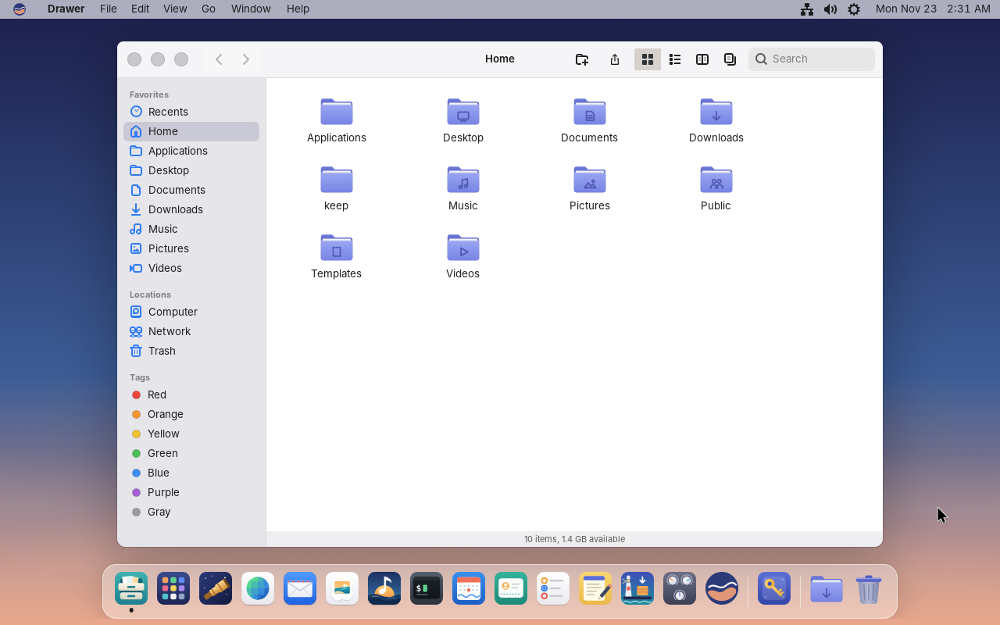
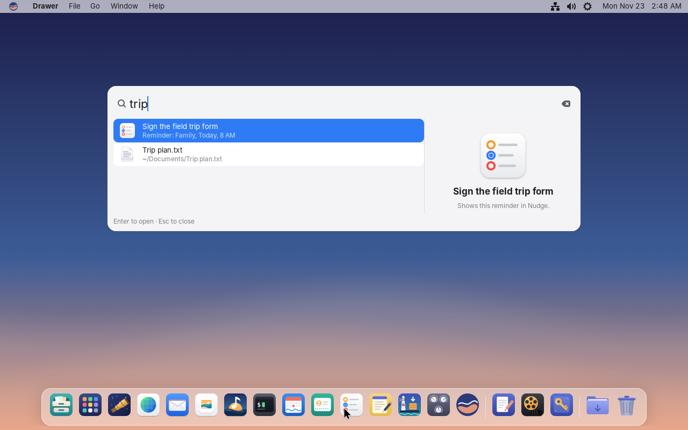
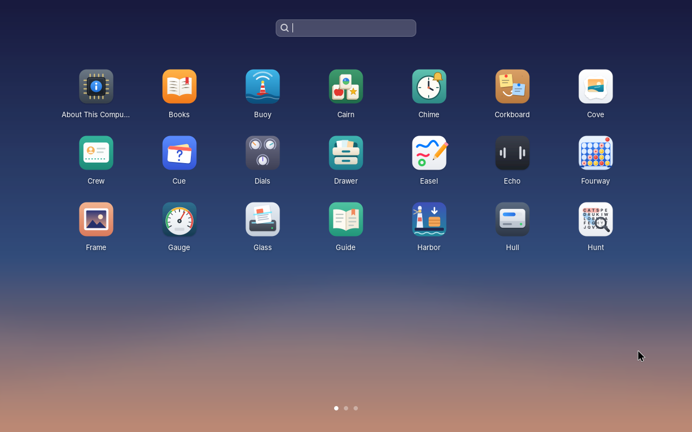
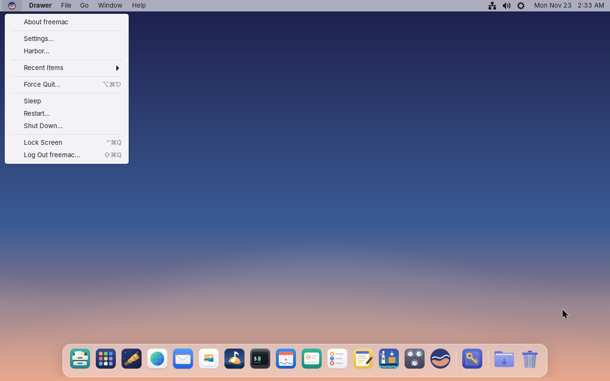
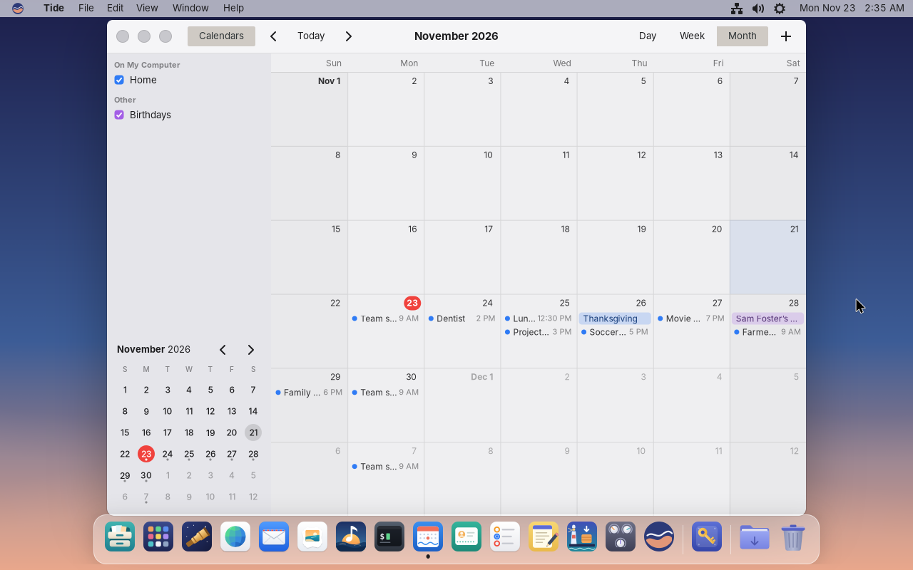
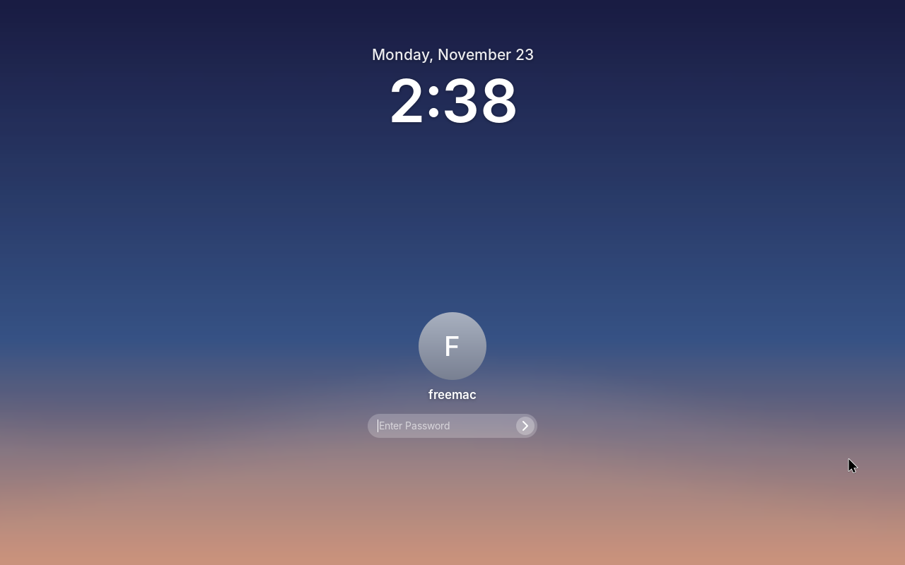
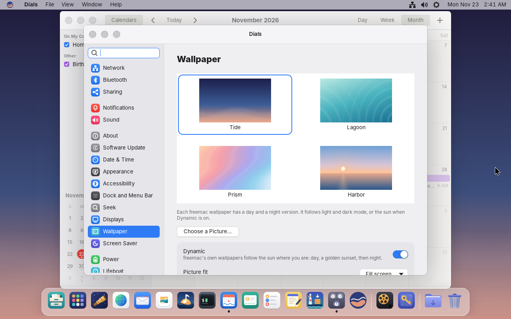
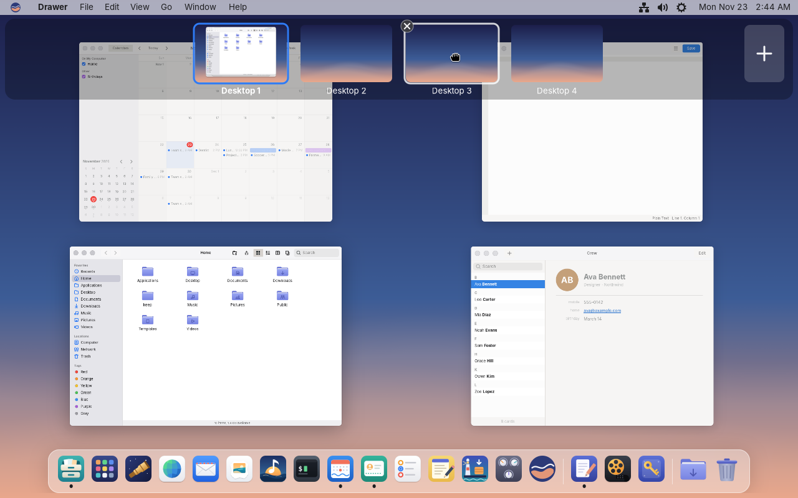

# freemac

freemac is an original, free operating system for ordinary x86-64 PCs whose
desktop *feels* like a classic Mac-style desktop: a global menu bar along the
top, a dock along the bottom, calm window chrome, a fast search launcher and
trackpad gestures that just work.

It is a small Linux distribution (Debian base) with its own Wayland desktop
shell. It is **not** macOS and it contains nothing from Apple. An optional
add-on, [Ferry](ferry/README.md), runs some simple command-line programs built
for Intel Macs; Mac apps in general, and App Store apps in particular, do not
run.

## Screenshots

Taken from the 1.122 live ISO in a virtual machine (QEMU, 1280×800). The
names, contacts and events in them are made-up examples.


<table>
<tr><td width="50%"><br><sub>Drawer, the file browser, with the menu bar and Dock</sub></td><td width="50%"><br><sub>Seek (⌘Space) finds files, apps, contacts, events and reminders</sub></td></tr>
<tr><td width="50%"><br><sub>All apps (F4 or the Dock's grid icon)</sub></td><td width="50%"><br><sub>The freemac menu at the left of the menu bar</sub></td></tr>
<tr><td width="50%"><br><sub>Quick settings from the menu bar</sub></td><td width="50%"><br><sub>Nudge, for reminders</sub></td></tr>
<tr><td width="50%"><br><sub>Tide, the calendar</sub></td><td width="50%"><br><sub>Crew, for contacts</sub></td></tr>
<tr><td width="50%"><br><sub>Dark mode, with the night wallpaper</sub></td><td width="50%"><br><sub>Dials, the settings app, in dark mode</sub></td></tr>
<tr><td width="50%"><br><sub>The lock screen</sub></td><td width="50%"><br><sub>Picture in Picture: a Reel video floating above Tide</sub></td></tr>
<tr><td width="50%"><br><sub>Dynamic wallpaper: the picture turns golden at sunset</sub></td><td width="50%"><br><sub>Stage Manager: one app in front, the others down the side</sub></td></tr>
<tr><td width="50%"><br><sub>Mission Control: add a desktop with +, close one from its corner, drag windows onto them</sub></td><td width="50%"><br><sub>Purser keeps website and Wi-Fi passwords, and warns about reused ones</sub></td></tr>
</table>

## Download

Each finished milestone is published as a ready-made live ISO on the
[Releases page](https://github.com/dean-plude/freemac/releases), with its
SHA-256 checksum and the virtual machine settings that work. Boot it in
QEMU, virt-manager, VirtualBox or VMware without building anything. Every
image is started in QEMU with both BIOS and UEFI firmware before it is
published.

## Clean-room rules

These rules apply to every commit, issue and pull request. A change that breaks
one of them will be reverted.

1. **No Apple material.** No Apple source code, binaries, firmware, kexts,
   frameworks, fonts, icons, cursors, wallpapers, sounds, screenshots or other
   artwork, in the repository or in built images.
2. **No reverse engineering of Apple software.** Do not disassemble, decompile,
   trace or dump macOS or any other Apple software, and do not use tools that do
   so on your behalf. Do not copy code or data obtained that way by anyone else.
3. **Design from public descriptions only.** Behaviour is designed from how the
   user experience is publicly described (articles, reviews, user guides,
   general knowledge of how such desktops work) and implemented from scratch.
4. **Original names and look.** Components get original names. Window buttons,
   icons and themes are our own designs. Do not imitate Apple's exact shapes,
   colours or layouts pixel for pixel.
5. **No Apple trademarks.** Do not use Apple, Mac, macOS, Finder, Dock,
   Spotlight, Mission Control or similar marks as names of anything we ship.
   (The repository name `freemac` is a working project name; a final product
   name may be chosen before any public release.)
6. **Only compatible open-source parts.** Third-party code must be under a
   licence compatible with GPL-3.0-or-later and must be recorded in
   [docs/ARCHITECTURE.md](docs/ARCHITECTURE.md).

## Target experience

| Feature | Our component | Status |
| --- | --- | --- |
| Global top menu bar with app menu, window menu, status icons, clock | **Topline** | 0.4: own bar with network, sound and battery icons; 0.5: clock opens the notification centre; 0.6: Lock Screen item; 0.8: GTK apps' own menus, Bluetooth and printing icons; 0.9: quick settings panel; 1.1: what's playing, with play/pause; 1.7: shortcuts in ⌘ symbols, the same app menu in every app, a Mac Window menu with Zoom; 1.8: slide along the bar between open menus, Settings… ⌘, in the app menu; 1.10: clicking the desktop makes Drawer the app in the bar, with File and Go menus; 1.12: Window > Fill and Center, and Hide leaves windows out of the Dock; 1.13: an app that stays open with no window keeps its name and menus in the bar, and the bar no longer switches to Drawer while ⌘Tab or Seek is up; 1.14: apps go by their short names, a Save dialog or alert keeps its app's menus, an app stays in front when its last window closes, and a window's commands are greyed out while its app has none; 1.15: an app with no window open keeps its shortcuts (⌘N in Jot); 1.16: apps that share no menus (Web, Firefox, VLC, Qt apps) still get File, Edit and Window menus, whose items press the app's own shortcuts; 1.17: Help in every app, where you type to find any menu item and press Return to run it; 1.19: Help closes on a click outside it; 1.20: Help lists Guide topics under the menu items; 1.21: Guide in the freemac menu, and Seek no longer lists open windows' names; 1.22: the clock opens a month calendar with the day's events from Tide; 1.25: an app's menus never show under another app's name while it opens or quits; 1.41: follows a new time zone at once; 1.51: Window > Move & Resize puts a window in a half or a quarter of the screen and back, and submenus in the bar open when the pointer rests on them; 1.64: hides itself until the pointer reaches the top of the screen (Dials); 1.70: the freemac menu in a Mac's order with Harbor, Recent Items (apps and documents, Clear Menu) and Sleep; Restart, Shut Down and Log Out (⇧⌘Q) ask first with a 60-second countdown and let each app save before going on; 1.74: an orange dot while an app is using the microphone and a green one for the camera, with the app's name a click away; the status icons on the right always take clicks; 1.76: low-battery warnings, sleeps at 2%; 1.80: the input menu (US, GB, DE…) switches keyboard layouts, as does ⌃Space; 1.95: rest the pointer on a window's green button for a menu of halves, quarters, Fill, Centre, Left & Right and Return to Previous Size |
| Bottom dock with magnification, running indicators | **Pier** | 0.4; 1.0: Downloads folder and a Trash you can empty; 1.2: icons bounce while an app starts and rise out of the dock when magnified; 1.9: drag apps along it or off it, drop files on an app to open them; 1.10: drop files on a Dock folder to move them there; 1.12: a minimized window shows as its own small picture beside the Trash; 1.13: Quill and Jot keep their dot with no window open, and clicking one opens a new window; 1.14: apps open at login get their dot straight away; 1.38: the app's name shows above its icon, magnification follows the pointer over the icons, a crowded Dock shrinks to fit the screen, and windows behind the Dock's clear top stay clickable; 1.42: hides itself until the pointer reaches the bottom of the screen (Dials or ⌥⌘D); 1.59: an app's menu lists the files it had open lately, and a right-click between the icons turns hiding and magnification on or off; 1.61: up to three apps used lately stay in the Dock after they quit, with Remove from Dock and a switch in Dials; 1.62: switches for the open-app dots and the bounce while an app opens; 1.63: sits on the left, bottom or right of the screen (Dials or its right-click menu), and desktop icons keep clear of it |
| Desktop wallpaper that fills any screen shape; files on the Desktop as icons | **Backdrop** | 0.4; 1.4: desktop icons; 1.25: USB drives, memory cards and phones mount as they're plugged in and show on the Desktop; drag one to the Trash to eject it; 1.26: copy, paste, Duplicate and Undo on the Desktop, and drop files onto a folder icon; 1.44: Use Stacks piles the Desktop's files by kind (a click fans a stack out), Clean Up By Name, Kind or Date Modified, and Get Info; 1.45: desktop widgets (clock, calendar, weather, reminders) you can drag anywhere; Edit Widgets… adds and removes them; 1.46: Space opens Glance on desktop files, and the arrow keys move from icon to icon; 1.48: tag desktop files with a colour from their menu; 1.49: New Folder with Selection; 1.50: Rotate Left, Rotate Right and Create PDF on pictures; 1.52: Show Item Info puts a picture's size or a folder's item count under its name; 1.55: Rename Items for several files at once; 1.57: Show View Options (⌘J) for icon size, grid spacing and text size; 1.67: click the wallpaper to reveal the desktop |
| Alt+Tab app switcher with large icons | **Tack** | 1.4; 1.13: apps open with no window are listed too, and picking one opens a window; 1.60: Q quits and H hides the chosen app while the switcher is up, hidden apps are dimmed, and a hidden app comes back whole; 1.62: ⌘← and ⌘→ move along the row |
| Window manager: left-side window buttons in our own style, window overview, virtual desktops | **Strata** (Wayfire config + theme) | 0.4: overview, 4 desktops, left buttons in freemac style on GTK apps; 0.8: own title bars for every app (strata-decor); 0.9: drag a window to an edge to tile it; 1.2: rounded title bars with round buttons that show their symbols on hover; 1.3: all four corners round, our own pointer, new windows clear of the menu bar; 1.12: minimizing shrinks a window down into its place in the Dock; 1.14: Save dialogs and alerts come down from the title bar as sheets and move with their window; 1.15: ⌘. cancels a dialog |
| File manager with icon, list, column and gallery views | **Drawer** | 0.4; 1.0: tabs, a sidebar you can change, Glance preview on Space; 1.1: compress to .zip, open .zip and tar archives; 1.2: Mac apps (.app) shown with their own icon; 1.6: Get Info (⌘I); 1.11: Favorites and Locations sidebar with blue icons; 1.21: Glance shows the first page of a PDF; 1.25: drives under Locations with an Eject button (⌘E); 1.25: Share, to mail files in Post or copy them to a drive; 1.26: copy and paste files (⌘C, ⌘V, ⌥⌘V to move), Duplicate (⌘D), drag onto folders, sidebar places and drives, a progress window with Stop, Keep Both or Replace for a taken name, and Undo (⌘Z); 1.46: pictures and PDFs show as small pictures of themselves, and Glance plays movies and music, shows every PDF page, steps through several files and fills the screen; 1.47: Put Back and Empty in the Trash, Open With, Sort By name, kind, date or size, a path bar (⌥⌘P) and Go to Folder (⇧⌘G); 1.48: coloured tags, with a dot after the name and a sidebar list of each colour's files; 1.49: Recents (⇧⌘F) with Show in Enclosing Folder, New Folder with Selection, and tags in Get Info; 1.50: spring-loaded folders (hold a drag on a folder to open it) and Quick Actions to rotate pictures or make a PDF of them; 1.52: a status bar with the item count, how many are selected and the space left (⌘/), and View > Show Sidebar; 1.53: Gallery view (⌘4), the chosen file large over a strip of the others, and the chosen files stay chosen when the view changes; 1.54: a Preview pane (⇧⌘P) with a large picture of the chosen file and its information; 1.55: Rename Items, to rename several files at once by replacing text, adding text or numbering them; 1.56: View Options (⌘J): icon size, grid spacing, text size, Show Item Info and Sort By; 1.72: Get Info shows which app opens a document, and Change All… makes another app open every document of that kind; 1.83: Connect to Server (⌘K) for shared folders on other computers (smb, sftp, ftp, WebDAV); 1.84: Network in the sidebar (⇧⌘K), the computers and shared drives nearby; 1.85: a computer in Network that shares several folders shows them to pick one, and a folder shared for everyone opens without asking for a password; 1.87: search This Mac from the toolbar, by name or by words inside documents, narrowed by kind and date, and Smart Folders that keep a search in the sidebar (⌥⌘N); 1.102: Drawer > Settings (⌘,): the folder new windows open in, the warning before emptying the Trash, removing items from the Trash after 30 days, and keeping folders on top |
| Full-screen grid of all apps (F4) | **Marina** | 1.2; 1.3: folders, and apps can be dragged into any order |
| ⌘Space search launcher (apps, files, sums) | **Seek** | 0.4; 1.0: finds files by the words inside them; 1.18: finds settings pages and the front app's menu items; 1.19: closes on a click outside it; 1.20: a preview of the chosen file, picture or app beside the results, and Guide topics; 1.21: a PDF's first page in the preview, and a nearly solid panel; 1.23: finds contacts, events and reminders, and opens faster; 1.68: unit conversions (5 km, 70 f to c, 2 cups in ml); 1.88: Dials > Seek chooses what it lists and keeps folders private |
| Settings app with light and dark mode | **Dials** | 0.4: appearance, wallpaper, dock, displays, trackpad and mouse, keyboard, network and Wi-Fi, about; 0.5: sound, power, notifications, accessibility; 0.7: users, Bluetooth, printers; 0.9: brightness, night light, changeable shortcuts; 1.6: Command key choices, start-up sound switch; 1.9: what a title-bar double-click does; 1.10: a grouped sidebar with each icon in a coloured tile; 1.11: search in the sidebar; 1.12: minimize windows into their app's icon; 1.19: opens in about half the time, building each page when it's first shown; 1.20: starts faster again, as every freemac app does, now that their code is compiled ahead in the image; 1.41: Date & Time (time zone by city, automatic time, 12 or 24 hours, day, date and seconds in the menu bar); 1.51: screen zoom on or off, and which key to hold while scrolling; 1.65: Reduce transparency and Invert colours (⌃⌥⌘8) in Accessibility; 1.66: Login Items, the apps that open when you log in; 1.71: Software Update page (Check for Updates, and security fixes installed automatically) and Network > Firewall, both behind an administrator's password; 1.72: choose the default web browser and email app; 1.73: Speak selection: select words in any app and press ⌥Esc to hear them read aloud, with a choice of voice and speed; 1.75: Accent colour (blue, purple, pink, red, orange, yellow, green, graphite) for every app, light and dark; 1.76: battery time left and Show percentage; 1.79: Sharing (computer name, Nearby sharing, Remote Login); 1.80: Input Sources (type in up to four languages or layouts, picked by name) and key repeat speed; 1.81: Check spelling while typing (red underlines and right-click corrections in every app where you write); 1.82: Text Replacements (omw becomes On my way!), smart quotes and dashes, and a full stop with a double space; 1.85: File Sharing, which shares your Public folder with the other computers on the network, to look at but not change; 1.86: Screen Sharing, so someone at another computer on the network can see and use this screen after signing in with your password; 1.88: Seek (what Seek lists, private folders it and Drawer leave out, Rebuild Index); 1.90: Users > Guest User, an account anyone can log in to without a password, whose files are erased when they log out; 1.91: Sound Effects (an alert sound of six, played at its own volume whenever an app can't do something, a pop as the volume changes, and a crumple and a shutter for the Trash and screenshots); 1.92: Displays shows each display's resolution, refresh rate, size of text and icons and rotation, asks "Keep these display settings?" for 15 seconds after a change, and with two or more displays lets you drag them into place and mirror one on another; 1.93: Use as Main display, or drag the white bar in the picture, to choose which display has the menu bar, the Dock and the files on the Desktop; 1.94: Flash the screen when an alert sound occurs, in Accessibility, with a Test Screen Flash button; 1.96: Shake mouse pointer to locate, in Accessibility: move the mouse quickly back and forth and the pointer grows big for a moment; 1.97: Press and hold for accents, in Keyboard: hold a letter such as e in a text field to pick é, è, ê and the rest from a small panel by the text cursor; 1.98: Sticky Keys, in Accessibility: tap ⇧, ⌃, ⌥ or ⌘ and it stays down for the next key, tap twice to lock it, or press Shift five times to turn it on or off; 1.99: Colour filters, in Accessibility: the screen in greys, adjusted for red/green or blue/yellow colour blindness, or tinted, at the intensity you choose; 1.100: Background sounds, in Accessibility: balanced, bright or dark noise, ocean, rain or a stream, playing steadily behind everything else at its own volume; 1.101: Appearance can be Auto (light while the sun is up, dark after it sets, where your time zone says you are), and Night Light can run from sunset to sunrise; 1.104: Pointer outline and fill colours, in Accessibility: the pointer drawn in any two colours, with Reset |
| Notifications with banners, a history list and Do Not Disturb | **Beacon** | 0.5; 1.58: notifications from one app stack together, Do Not Disturb on a daily schedule, and a choice for each app (Banners, Notification Centre only or Off) in Dials |
| Screenshots of the screen, an area or a window (⇧⌘3, ⇧⌘4 or the Print key) | **Lens** | 0.5; 1.1: screen recording (Ctrl+Print); 1.7: a small picture in the corner after each screenshot; 1.21: clicking it opens the screenshot in Frame, not the web browser; 1.78: the Screenshot toolbar on ⇧⌘5, with Options for where to save, a timer and the thumbnail |
| Notes, saved as plain text files as you type | **Jot** | 1.1; 1.13: stays open with no window, and File > New Note works from the menu bar; 1.14: hints show ⌘N; 1.15: ⌘N works with no window open |
| Short how-to topics (the Command key, windows, screenshots, Wi-Fi and more), found from Help and Seek | **Guide** | 1.20; 1.21: also in the freemac menu and on Welcome's last page |
| Volume, brightness and media keys with an on-screen level | freemac-keys, **Beacon** | 1.1 |
| Clipboard history (Super+Shift+V) | freemac-clips | 1.1 |
| Hot corners | **Strata**, Dials | 1.1 |
| Force Quit window on ⌥⌘⎋ for an app that has stopped answering | **Force Quit**, Strata | 1.9 |
| Alerts in a small panel with the app's icon on top and equal buttons, used by every freemac app | alert.py, theme | 1.10 |
| Text editor | **Quill** | 0.5; 1.13: stays open with no window; ⌘Q asks about unsaved changes, then quits; 1.15: a small Save sheet (name and where) that opens out to the full browser |
| Picture and PDF viewer | **Frame** | 0.5; 1.21: opens PDFs, page by page, and is the default for them; 1.22: Markup (⇧⌘A): draw, boxes, text and a signature drawn once on a pad, saved as a copy beside the original; 1.25: Share |
| Calendar with day, week and month views, events that repeat, kept as a standard .ics file | **Tide** | 1.22; 1.23: notices before events, Crew's birthdays; 1.24: online calendars; 1.25: a colour for each calendar and a Calendars list to show or hide each one, with a month to jump from |
| Contacts, kept as one standard .vcf card per person | **Crew** | 1.22; 1.24: online address books |
| Reminders in coloured lists, with due dates, flags and a notice when one is due | **Nudge** | 1.23; 1.24: online reminder lists |
| Internet Accounts: sign in once (iCloud, Fastmail, Yahoo, Nextcloud or any CalDAV and CardDAV server) and its calendars, contacts and reminders stay in step both ways | **Dials**, freemac-sync | 1.24 |
| Emoji and symbols: search or browse, then type the chosen one into the app in front (Control-⌘-Space, or Edit > Emoji & Symbols) | **Glyph** | 1.24 |
| Photos: everything in your Pictures folder by month, a large view with favourites, and import from a camera, phone or memory card | **Cove** | 1.24; 1.25: albums you make and name, photos added by drag or right-click, and a slideshow of any album or the whole library; Share, to mail photos or copy them to a drive |
| Music: the songs in your Music folder by album, artist and song, with album covers, shuffle and repeat, songs played one after another with no gap, and the media keys and menu bar's what's playing | **Shanty** | 1.27 |
| Videos: plays them in a window or full screen, with controls that fade away, and starts each where you stopped | **Reel** | 1.28 |
| Picture in Picture: a video in a small window that floats above the others in a corner while you work, and drags anywhere | **Reel**, **Strata** | 1.105 |
| Dynamic wallpaper: freemac's own scenes follow the sun where you are, day while it's high, golden as it sets, then night | **Backdrop**, **Dials** | 1.106 |
| Mission Control: drag a window up onto one of the desktops along the top to move it there | **Strata**, **Topline** | 1.109 |
| Mission Control: add a desktop with + (or drag a window onto it), close one with the button on its corner; the count is kept | **Strata**, **Topline** | 1.110 |
| Dock > Options > Assign To: keep an app on All Desktops or on This Desktop (its windows open there and take you there) | **Pier**, **Strata** | 1.111 |
| App Exposé: Ctrl+Down, a four-finger swipe down, or Dock > Show All Windows spreads out just the windows of one app | **Strata**, **Pier** | 1.112 |
| Screen reader: Command+F5 (or Dials > Accessibility) speaks what's on the screen, the control you move to and what you type, and comes back at the next login | **Dials**, **Strata**, Orca | 1.120 |
| Passwords: Web saves and fills in website logins in a keychain opened by your login password, and Purser shows, copies, changes and checks them (reused or easy to guess), with Wi-Fi passwords too | **Purser**, **Dials**, gnome-keyring | 1.122 |
| Known Wi-Fi networks in Dials > Network: show or copy a saved password after an administrator's password, a QR code a phone scans to join, join automatically, forget | **Dials** | 1.121 |
| Dials shows a red count beside Software Update when updates are ready, and Dock badges come back if the Dock restarts | **Dials**, **Pier** | 1.118 |
| Software update notices: freemac looks for updates once a day, says when some are ready, and Harbor's Dock icon shows how many | **Beacon**, **Harbor**, **Pier** | 1.117 |
| Windows come forward when you ask: open a link or an app that's already open and its window comes to the front, on its own desktop; an app in the background that needs you bounces in the Dock until you go to it | **Strata**, **Pier** | 1.116 |
| Dock badges: a red number on an app's icon for unread mail in Post, reminders due in Nudge, or any app that sends a count | **Pier**, **Post**, **Nudge** | 1.115 |
| Mission Control on an empty desktop: Control+Up still shows your desktops along the top, so you can pick one or add another | **Strata**, **Topline** | 1.114 |
| Full screen gets its own desktop: the window slides onto a new desktop named after its app in Mission Control, and slides back when it leaves full screen | **Strata**, **Topline** | 1.113 |
| Mission Control: the window overview names your desktops along the top; move the pointer up to see a picture of each, and click one to go there | **Strata**, **Topline** | 1.108 |
| Stage Manager: the app you're using stands alone in the middle, the apps you used just before it wait as small pictures down the left, and a click brings one forward | **Pier**, **Strata**, **Quick Settings** | 1.107 |
| Keep the screen on while a video plays, or for as long as you ask (`caffeinate` in Terminal) | **Strata**, **Latch** | 1.103 |
| Activity Monitor: each app's share of the processor and memory, every process if you like, a graph of the last two minutes, and Quit or Force Quit for one that's stuck | **Gauge** | 1.28 |
| Disk Utility: every drive with how full it is, and Rename, Erase (ExFAT, MS-DOS or ext4) and Eject, with no password for USB drives | **Hull** | 1.28 |
| Camera: take pictures of yourself after a 3, 2, 1 countdown, with fun effects that bend and colour the picture | **Pose** | 1.29 |
| Weather: now, the next 24 hours and the next 10 days for the places you add, no account needed | **Sky** | 1.29 |
| Sticky notes: little coloured notes that stay on the desktop and come back after a restart | **Stickies** | 1.29 |
| Voice Memos: record with one big button, play back, rename and trim, kept in Music/Echo | **Echo** | 1.30 |
| Drawing: pens, a highlighter, shapes, text, stickers, an eraser and undo on a big canvas, kept as you go and exported as a picture | **Easel** | 1.30 |
| Chess against the computer (Easy, Medium, Hard) or a friend on the same screen, with hints and take-backs | **Rook** | 1.30 |
| Patience (solitaire): drag cards or double-click to send them home, draw one or three, undo, hints, and the cards finish themselves | **Patience** | 1.31 |
| Mines: clear a field in three sizes; the first click is always safe, right-click flags, best times kept | **Mines** | 1.31 |
| Read EPUB e-books: a shelf with covers, page by page, a contents list, bigger text, light, sepia or night pages, and your place kept | **Books** | 1.31 |
| Play the piano with the mouse or the keyboard: piano, organ, music box, flute and synth sounds made by freemac itself, and record a tune to play back | **Ivory** | 1.32 |
| A dictionary that works without the internet: what a word means, examples, words that mean the same or the opposite, and a word of the day (from WordNet) | **Words** | 1.32 |
| Learn to type: lessons that add a few keys at a time, a keyboard that shows the next key and which finger to use, speed, accuracy and stars kept | **Typist** | 1.32 |
| Screen time: how long each app was used today and over the week, and daily limits with a warning before time is up and an optional passcode | **Logbook** | 1.33; 1.69: Limit adult websites, for the whole computer; 1.89: Downtime (hours away from the screen when only Always Allowed apps work), Always Allowed apps with no limit, and 15 More Minutes behind the passcode |
| A number puzzle (sudoku) from easy to expert, with pencil marks, hints, undo and best times | **Nine** | 1.33 |
| A font book: every font in all its styles, a sample you can type, and adding or removing fonts (double-click a font file to install it) | **Typecase** | 1.33 |
| A memory game: turn over two cards at a time to find the pairs, alone or with two players taking turns | **Pairs** | 1.34 |
| A graphing calculator: type equations such as y = x^2 or sin(x), see them in colour, zoom and drag, and read off any point | **Plot** | 1.34 |
| A whiteboard: sticky notes, text, shapes, arrows and pictures on a big board, with as many boards as you like | **Corkboard** | 1.34 |
| A jigsaw puzzle: real-shaped pieces cut from a built-in picture or one of your own photos, 12 to 100 pieces, that click together when they fit | **Jigsaw** | 1.35 |
| About this computer: processor, memory, graphics and storage at a glance, and a full system report you can copy | **Manifest** | 1.35 |
| A colour picker: pick a colour from anywhere on the screen with a magnifying loupe, copy it as hex, RGB or HSL, and keep a palette | **Swatch** | 1.35 |
| A shape puzzle: slide, turn and flip seven pieces to fill an outline, with twelve shapes from a square to a cat and a hint when you're stuck | **Tangram** | 1.36 |
| Podcasts and news feeds: subscribe by a feed or a website's address, read new posts, and play episodes at the speed you like with your place kept | **Buoy** | 1.36 |
| A word search: find hidden words in a grid, with twelve themes, three sizes and best times | **Hunt** | 1.36 |
| Four in a row: drop counters into a stand against the computer at three levels or a friend | **Fourway** | 1.37 |
| Draughts (checkers) with compulsory jumps and kings, against the computer at three levels or a friend, with the legal moves marked | **Kings** | 1.37 |
| Tile-matching solitaire: clear stacks of picture tiles by matching free pairs, in four layouts that can always be cleared | **Cairn** | 1.37 |
| Maths practice for children: adding, taking away, times tables and sharing at five levels each, with stars and a times-table chart | **Sums** | 1.38 |
| Flashcards: decks of questions and answers, studied so the cards you know least come back most often, and brought in from a spreadsheet file | **Cue** | 1.38 |
| Scanning from USB and network scanners and all-in-one printers: preview, pick part of the glass, colour and resolution, and save a many-page PDF or pictures | **Glass** | 1.38 |
| Spreadsheets: cells with formulas (SUM, AVERAGE, IF, COUNTIF and more), number formats, fill down, sorting, charts of the selected cells, and CSV files | **Ledger** | 1.39 |
| Presentations: slides with a title, points and a picture in six original themes, a full-screen show and PDF export | **Lantern** | 1.39 |
| Nearby sharing: send files over Wi-Fi to other freemac computers and to phones with the free LocalSend app; offers ask before anything is taken, and land in Downloads | **Hail** | 1.77 |
| Screen Sharing viewer: see and use another computer on the network that shares its screen (freemac, or any VNC computer such as a Mac), after signing in with that computer's name and password; encrypted, and it warns if the computer isn't the same one as before | **Porthole** | 1.86 |
| Mail: your IMAP accounts' mailboxes, reading with pictures from the internet held back until you ask, replying, forwarding, attachments and drafts | **Post** | 1.24; 1.25: a new message with files attached when you Share from another app |
| Backups: your home folder copied to a drive every hour, earlier backups kept with unchanged files shared, and any file or folder brought back from a backup chosen by date | **Lifeboat** | 1.27 |
| Recovery: hold Ctrl as the computer starts to bring back a backup, reset a password, check a disk or reinstall | **Recovery** | 1.40 |
| Runs simple Intel Mac command-line programs (optional add-on) | **Ferry** | 0.5: first version |
| App centre for open-source apps, with system updates | **Harbor** | 0.6 |
| Lock screen (Ctrl+Command+Q, idle and before sleep) | **Latch** | 0.6; 1.3: laid out like the login screen; 1.43: waits for the screen saver to end, then asks for the password |
| Screen savers: Drift, Clock and Album (your photos) | **Screen Saver** | 1.43: chosen in Dials > Screen Saver, starts after a few idle minutes or from a hot corner |
| Calculator | **Tally** | 0.6 |
| Clock with world clocks, alarms, timers and a stopwatch | **Chime** | 0.6 |
| Original app icons, folder and file icons, and day/night wallpapers | freemac theme | 0.7: 10 app icons, 17 folder and file icons, 4 wallpaper scenes; 1.2: every app's icon on the same rounded tile, a full GTK theme of our own, Inter as the system font |
| Start-up screen instead of a boot menu and text | build | 1.2 |
| First-run setup: light or dark, wallpaper, Wi-Fi, shortcuts | **Welcome** | 1.0 |
| Installer | **Keel** | 0.4: whole-disk install, BIOS and UEFI |
| Login screen | **Gangway** | 0.4; 1.2: blurred wallpaper, round picture, password field with an arrow; 1.90: the Guest User logs in with just the arrow, and the login screen comes back after logging out (it was black) |
| Sound (PipeWire) with a volume control in the menu bar | Topline | 0.4 |
| A start-up sound of its own (four soft bell notes, made by our own code), which can be turned off in Dials > Sound | art, Dials | 1.6 |
| Trackpad gestures (switch desktops, overview) | **Strata** gestures | configured, not yet tested on hardware |
| Bootable live ISO | `build/build-iso.sh` | done |

## Roadmap

- **Milestone 1: bootable base.** Reproducible script that builds a live ISO
  (BIOS and UEFI) from a pinned Debian release and boots in QEMU to an
  auto-logged-in console. *(done, 0.1.0)*
- **Milestone 2: graphical session.** Wayfire configured as Strata, greetd
  autologin straight into the Wayland desktop, original wallpaper, a Welcome
  app, window overview, four desktops, gestures, and left-side window buttons
  on GTK apps. wf-shell's bar and dock stand in for Topline and Pier.
  *(0.2.0)*
- **Milestone 3: shell.** Topline menu bar and Pier dock as layer-shell
  clients; Seek launcher on Super+Space. *(0.4.0)*
- **Milestone 4: apps.** Drawer file manager (icon, list and column views) and
  Dials settings (appearance, light/dark, wallpaper, dock, displays, trackpad,
  keyboard, network). *(0.4.0)*
- **Milestone 5: polish.** Keel installer and Gangway login screen *(0.4.0)*;
  original icons and more wallpapers came in 0.7, our own title bars and
  GTK app menus in Topline in 0.8, menu bars in every freemac app in 0.9, File and Edit menus for apps that share none in 1.16; still to do: gestures
  tested on real trackpads.
- **Milestone 6: Mac app compatibility (experimental).** Ferry, our own
  optional layer that runs some programs built for Intel Macs, the way Wine
  runs Windows programs. Written from public documentation only. See
  [Mac app compatibility](docs/ARCHITECTURE.md#mac-app-compatibility-optional-layer).
- **Milestone 7: release.** Signed images, package repository, docs.

From 0.5 on, work is planned in batches of features; the current list is in
[docs/ROADMAP.md](docs/ROADMAP.md).

## Running Mac apps

freemac is not macOS and does not include it. Mac program support comes from
Ferry, our own optional, experimental compatibility layer (milestone 6), and
its limits are real:

- **App Store apps are not supported.** They are encrypted and tied to Apple's
  DRM and Apple ID, and freemac will not try to work around that.
- Only apps built for Intel (x86-64), or universal apps, can run on a PC. Apps
  built only for Apple silicon cannot.
- Ferry today runs simple command-line programs only. Graphical apps need
  Mac frameworks Ferry doesn't have; most everyday Mac apps will not work for
  a long time, if ever. See [ferry/README.md](ferry/README.md).

Mac apps still look like themselves on freemac: put a `.app` in the
Applications folder (or use Add to Applications in Drawer) and it appears in
the app grid, dock and search with its own icon, read from the app itself.
Opening one runs it through Ferry when Ferry is installed and the program is
simple enough; otherwise freemac says plainly that it can't run yet.

For apps that matter, the dependable route is the Linux or web version of the
app, or a free alternative; Harbor, the app centre, lists those.

## Building

You need a Debian or Ubuntu build host, root (the build uses `chroot`) and
about 10 GB free.

```sh
sudo apt-get install debootstrap squashfs-tools xorriso grub-pc-bin \
  grub-efi-amd64-bin grub-common mtools dosfstools qemu-system-x86 ovmf
sudo ./build/build-iso.sh            # writes out/freemac-<version>-amd64.iso
```

Options are environment variables, for example:

```sh
sudo BASE=debian SUITE=trixie MIRROR=http://deb.debian.org/debian ./build/build-iso.sh
sudo SNAPSHOT=20261101T000000Z ./build/build-iso.sh   # pin to snapshot.debian.org
sudo BASE=ubuntu ./build/build-iso.sh                 # fallback base (Ubuntu 24.04)
```

## Testing in QEMU

```sh
./scripts/run-qemu.sh out/freemac-*-amd64.iso          # BIOS, window
./scripts/run-qemu.sh --uefi out/freemac-*-amd64.iso   # UEFI (needs OVMF)
./scripts/run-qemu.sh --serial out/freemac-*-amd64.iso # no window, serial console
```

The raw command it runs is:

```sh
qemu-system-x86_64 -m 2048 -smp 2 -cdrom out/freemac-0.4.0-amd64.iso \
  -boot d -vga virtio -enable-kvm -cpu host
```

Tested so far (Nov 2026), on the `BASE=ubuntu` image in QEMU:

- 0.4.0 live session: the desktop starts on its own with Topline, Pier, the
  wallpaper, network and sound icons; Seek, Drawer (all three views), Dials
  and light/dark mode work, and wired networking comes up through
  NetworkManager.
- Keel installed 0.4.0 to an empty 20 GB virtual disk. The installed system
  boots under both BIOS and UEFI (OVMF) to the Gangway login screen; a wrong
  password is refused and the right one opens the desktop.
- 0.9.0 live session: app menus show in Topline (Tally's View menu switches
  its scientific keys), dragging a window to the screen's edge tiles it, the
  quick settings panel opens from the gear and hides Wi-Fi, Bluetooth and
  brightness on a machine without them, Dials > Keyboard lists the shortcuts,
  and switching night light on starts wlsunset with the chosen hours. QEMU's
  own screen capture can show stale patches of the menu bar without a GL
  display; the compositor's picture (grim) is clean.

Not tested yet: real PC hardware, Wi-Fi (the virtual machine has none),
laptop batteries and trackpads, and the default `BASE=debian` build, which
uses the same script and package lists but couldn't be built on the first
build host because it couldn't reach Debian mirrors.

### Desktop shortcuts

Command (⌘) is the key next to the space bar: Alt on most PC keyboards, with
Option (⌥) beside it, as on a Mac keyboard. Dials > Keyboard can make the
Windows key Command instead (for a Mac keyboard). Command with a key does in
every app what Ctrl does on other PCs: Command+C copies, Command+V pastes,
Command+Z undoes, Command+S saves, Command+T opens a tab, and so on (in a
terminal, Command+C copies). Command+Left/Right go to the start or end of the
line and Option+Left/Right move a word.

| Keys or gesture | Action |
| --- | --- |
| Command+Space | Seek: search apps and files, or type a sum |
| Command+Tab | Switch apps (hold Command, press Tab, let go); Alt+Tab works too |
| Command+` | The app's next window |
| Command+Q / Command+H / Option+Command+H | Quit the app / hide it / hide the others |
| Command+M | Minimise the window |
| Control+Command+F | Full screen |
| Command+F3 | Show the desktop |
| Ctrl+Up, 4-finger swipe up | Show all windows |
| Ctrl+Down, 4-finger swipe down | App Exposé: every window of the app in front |
| Ctrl+Option+Down | Show all desktops |
| Ctrl+Left / Ctrl+Right, 3-finger swipe | Switch desktop |
| Ctrl+Shift+Left / Right | Move the window to the next desktop |
| Control+Command+Left / Right / Up / Down | Fill the left / right half, the screen, or back |
| Control+Command+Q | Lock the screen |
| Ctrl+Alt+T | Terminal |
| Shift+Command+V | Clipboard history |
| Shift+Command+3 / 4 (or Print / Shift+Print) | Screenshot of the screen / an area |
| Alt+Print | Screenshot of the window |
| Shift+Command+5, Ctrl+Print / Ctrl+Shift+Print | Record an area / the screen / an area (press again to stop) |
| Volume, brightness and media keys | Change the level, shown near the bottom of the screen; play/pause, next, previous |

In Drawer: Ctrl+1/2/3 switch between icon, list and column views, Ctrl+H
shows hidden files, F2 renames, Delete moves to the Trash, Space shows a
preview (Glance, which also works on the desktop), Ctrl+T opens a tab and Ctrl+Tab moves between tabs.
Shift+Command+G goes to a folder you type, Option+Command+P shows the path bar, and Command+Delete
in the Trash puts a file back.

## Installing

Start the live ISO and choose **Install freemac…** in the Welcome window (or
search for it with Super+Space). Keel asks for a disk and your account, erases
that disk, and installs freemac so it starts on both BIOS and UEFI PCs. It
uses the whole disk; dual-booting isn't supported yet. The boot loader is not
signed, so turn Secure Boot off first.

If you installed freemac from a download older than 1.116, some system
folders (`/`, `/etc`, `/usr` and parts of them) belong to account number 1001,
which is the second account you make on that PC, instead of to the system.
That account could change the system. Run this once in Terminal to give them
back to the system (it asks for your password):

```sh
sudo chown root:root / && sudo find /etc /usr -xdev \( -uid 1001 -o -gid 1001 \) -exec chown -h root:root {} +
```

The live session logs in automatically as user `freemac` (desktop on VT 7, text console on VT 1) (no password; `sudo`
works without one on the live image).

## Licence

freemac's own code is licensed under the GNU General Public License v3.0 or
later; see [LICENSE](LICENSE). Third-party components keep their own licences,
listed in [docs/ARCHITECTURE.md](docs/ARCHITECTURE.md).
